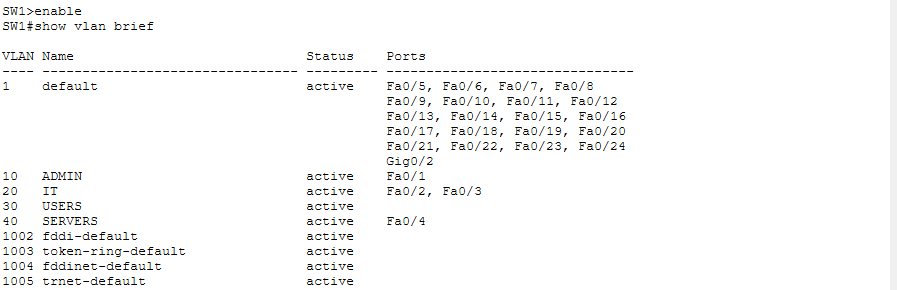
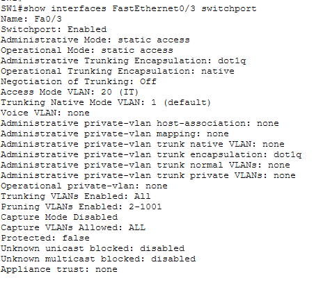
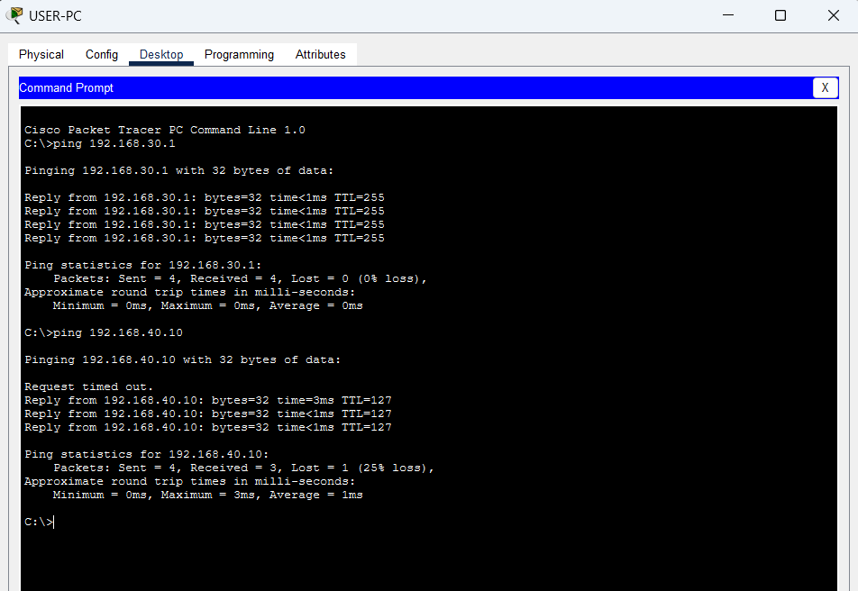

# Incident Report 02 – VLAN Mismatch

## 1. Incident Overview

- **Incident:** Incorrect VLAN assignment
- **Affected device:** USER-PC
- **Switch:** SW1
- **Affected interface:** FastEthernet0/3
- **Expected VLAN:** VLAN 30 – Users
- **Severity:** Medium
- **Category:** Layer 2 configuration error

## 2. Problem Description

USER-PC was connected to SW1 FastEthernet0/3, but the switch port was mistakenly assigned to VLAN 20 instead of VLAN 30.

This prevented the workstation from communicating correctly with its intended VLAN 30 network.

## 3. Faulty Configuration

```cisco
interface FastEthernet0/3
 switchport mode access
 switchport access vlan 20
```

### Evidence – Initial Fault



*Figure 1: FastEthernet0/3 incorrectly assigned to VLAN 20.*

## 4. Root Cause

The switch access port was assigned to the wrong VLAN.

USER-PC belongs to VLAN 30, but its switch port was configured for VLAN 20.

## 5. Troubleshooting

1. Tested connectivity from USER-PC using `ping`.
2. Inspected VLAN assignments using:

```cisco
show vlan brief
```

3. Identified FastEthernet0/3 in VLAN 20.
4. Inspected the interface configuration using:

```cisco
show interfaces FastEthernet0/3 switchport
```

5. Confirmed that the port should belong to VLAN 30.

### Evidence – Diagnosis



*Figure 2: Interface details confirm that FastEthernet0/3 is operating in VLAN 20.*

## 6. Corrective Action

Reassigned the switch port to VLAN 30:

```cisco
configure terminal
interface FastEthernet0/3
switchport access vlan 30
end
```

## 7. Verification

- USER-PC to default gateway: Successful
- USER-PC to server: Successful
- Network communication: Restored

### Evidence – Successful Recovery



*Figure 3: FastEthernet0/3 assigned to VLAN 30 and successful connectivity tests.*

## 8. Lessons Learned

- Access ports must be assigned to the correct VLAN.
- VLAN mismatches can prevent devices from reaching their intended network.
- `show vlan brief` is useful for identifying incorrect VLAN assignments.
- `show interfaces switchport` provides detailed information about an interface's VLAN configuration.