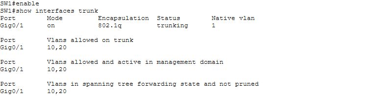
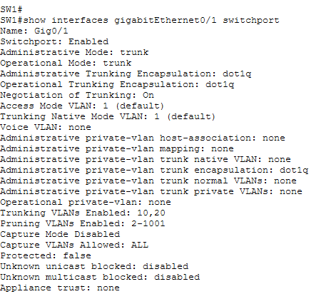
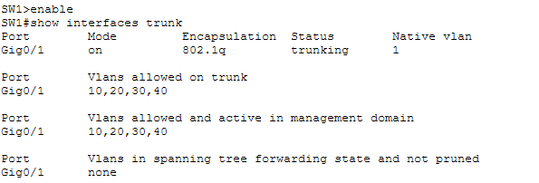
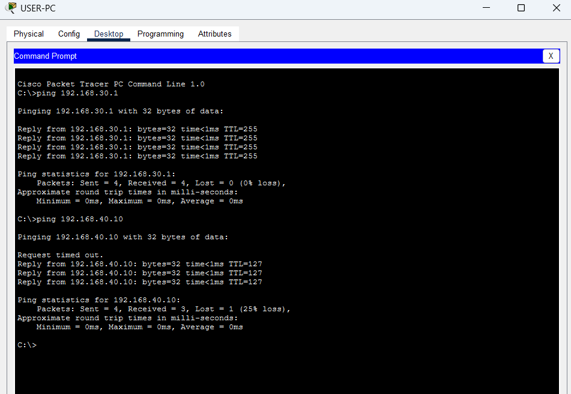

# Incident Report 03 – Trunk Allowed VLAN Misconfiguration

## 1. Incident Overview

- **Incident:** VLANs missing from trunk allowed list
- **Affected device:** SW1
- **Affected interface:** GigabitEthernet0/1
- **Severity:** High
- **Category:** Layer 2 configuration error

## 2. Problem Description

The trunk link between SW1 and R1 was configured to allow only VLANs 10 and 20.

VLANs 30 and 40 were excluded, preventing traffic from the Users and Servers VLANs from crossing the trunk link.

## 3. Faulty Configuration

```cisco
interface GigabitEthernet0/1
 switchport mode trunk
 switchport trunk allowed vlan 10,20
```

### Evidence – Initial Fault



*Figure 1: The trunk allowed VLAN list contains only VLANs 10 and 20.*

## 4. Root Cause

The trunk allowed VLAN list was incomplete. VLAN 30 and VLAN 40 traffic was blocked from traversing the trunk.

## 5. Troubleshooting

1. Tested connectivity from USER-PC.
2. Inspected trunk configuration using:

```cisco
show interfaces trunk
```

3. Identified that only VLANs 10 and 20 were allowed.
4. Inspected the switchport configuration using:

```cisco
show interfaces GigabitEthernet0/1 switchport
```

5. Confirmed that VLANs 30 and 40 were missing from the allowed VLAN list.

### Evidence – Diagnosis



*Figure 2: Interface details confirm that only VLANs 10 and 20 are allowed on the trunk.*

## 6. Corrective Action

Updated the allowed VLAN list:

```cisco
configure terminal
interface GigabitEthernet0/1
 switchport trunk allowed vlan 10,20,30,40
end
```

## 7. Verification

- USER-PC to default gateway: Successful
- USER-PC to server: Successful
- VLAN 30 and VLAN 40 traffic: Restored

### Evidence – Trunk Configuration Verification



*Figure 3: VLANs 10, 20, 30 and 40 are now allowed on the trunk.*

### Evidence – Connectivity Verification



*Figure 4: Successful connectivity between USER-PC, its default gateway and the server.*

## 8. Lessons Learned

- Trunk links must allow all required VLANs.
- An incomplete allowed VLAN list can interrupt communication across multiple network segments.
- `show interfaces trunk` helps identify trunk configuration problems.
- Verifying both trunk configuration and end-to-end connectivity is important after remediation.