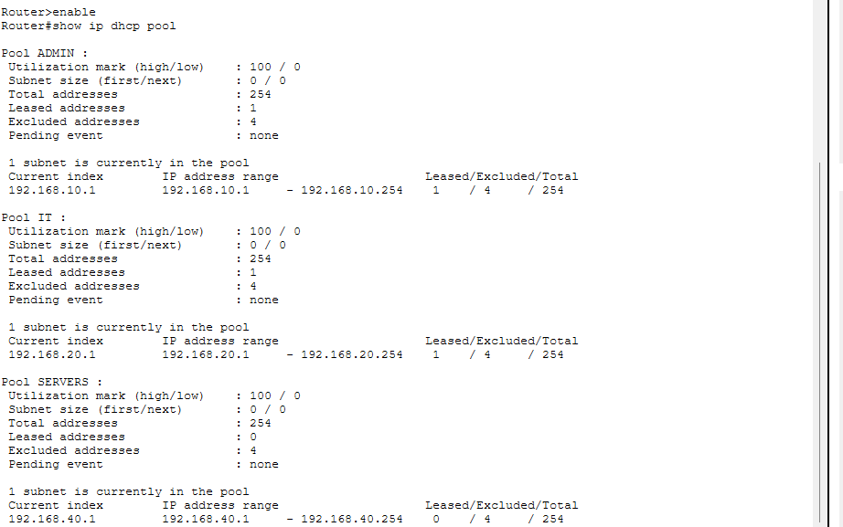
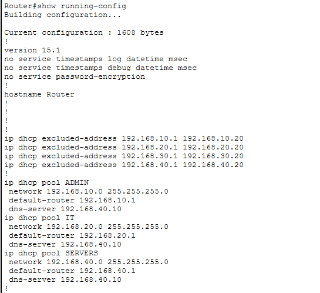
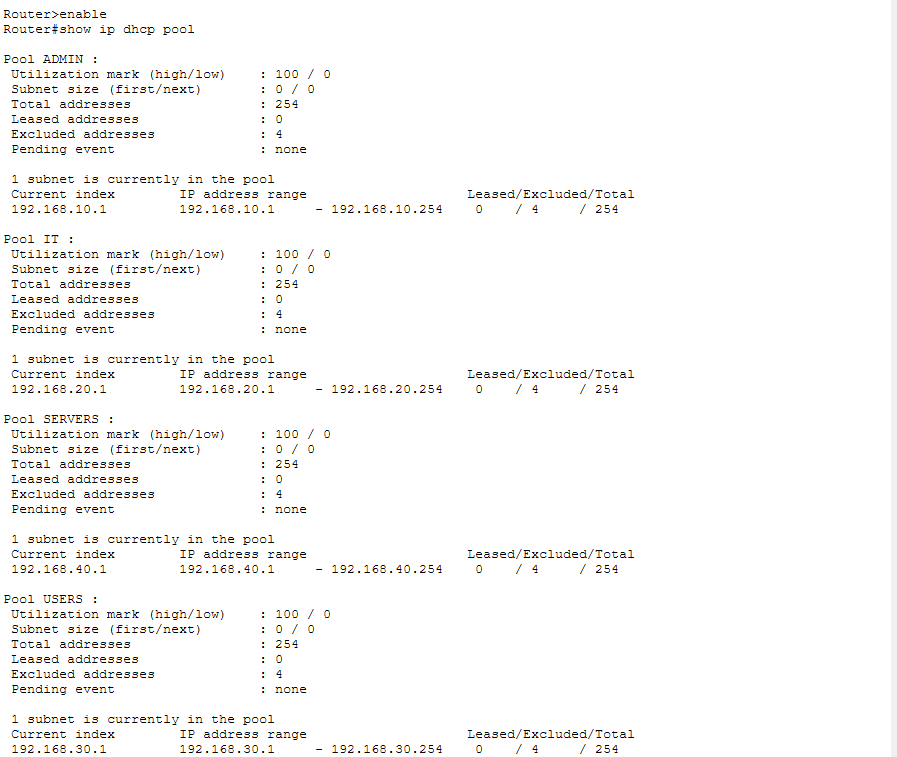
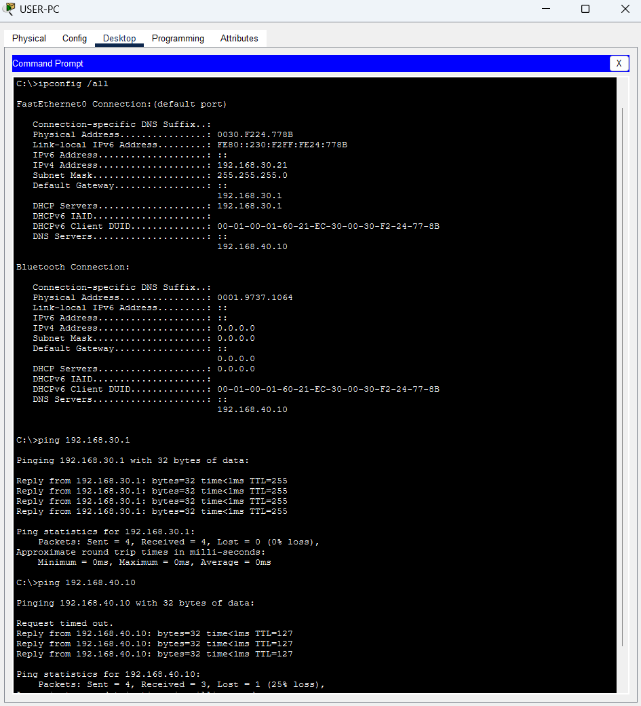

# Incident Report 05 – DHCP Pool Deletion

## 1. Incident Overview

- **Incident:** DHCP pool accidentally deleted
- **Affected device:** R1
- **Affected network:** VLAN 30 – Users
- **Affected DHCP pool:** USERS
- **Severity:** High
- **Category:** Network services configuration error

## 2. Problem Description

The DHCP pool named `USERS` was accidentally deleted from router R1.

As a result, USER-PC could not obtain an IPv4 address automatically through DHCP.

## 3. Faulty Configuration

The DHCP pool was missing from the router configuration.

The following command was used to identify the issue:

```cisco
show ip dhcp pool
```

The output did not contain the `USERS` pool.

### Evidence – Initial Fault



*Figure 1: The USERS DHCP pool is missing from the router.*

## 4. Root Cause

The DHCP pool responsible for assigning IP addresses to VLAN 30 clients had been removed.

Without this pool, clients in VLAN 30 could not obtain their required network configuration through DHCP.

## 5. Troubleshooting

1. Checked USER-PC's IP configuration using `ipconfig`.
2. Identified that the workstation had not received a valid DHCP configuration.
3. Inspected available DHCP pools using:

```cisco
show ip dhcp pool
```

4. Inspected the router configuration to investigate the missing DHCP pool.
5. Confirmed that the `USERS` pool was missing.

### Evidence – Diagnosis



*Figure 2: Router configuration confirms that the USERS DHCP pool is missing.*

## 6. Corrective Action

Recreated the DHCP pool on R1:

```cisco
configure terminal
ip dhcp excluded-address 192.168.30.1 192.168.30.20
ip dhcp pool USERS
 network 192.168.30.0 255.255.255.0
 default-router 192.168.30.1
 dns-server 192.168.40.10
end
```

The excluded address range prevents DHCP from assigning reserved addresses.

## 7. Verification

- DHCP pool successfully recreated.
- USER-PC received an IPv4 address automatically.
- Default gateway configuration restored.
- DNS server configuration restored.
- Connectivity to the gateway and server: Successful.

### Evidence – DHCP Configuration Verification



*Figure 3: The USERS DHCP pool has been successfully recreated with the required network settings.*

### Evidence – Connectivity Verification



*Figure 4: USER-PC received its network configuration and successfully communicated with the gateway and server.*

## 8. Lessons Learned

- DHCP pools are essential for automatic IP address assignment.
- Excluded addresses prevent DHCP from assigning reserved addresses.
- `show ip dhcp pool` helps verify DHCP pool configuration.
- DHCP clients require a valid IP address, subnet mask, default gateway, and DNS server.
- DHCP configuration should be verified after restoring a deleted pool.