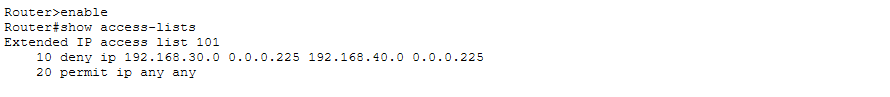
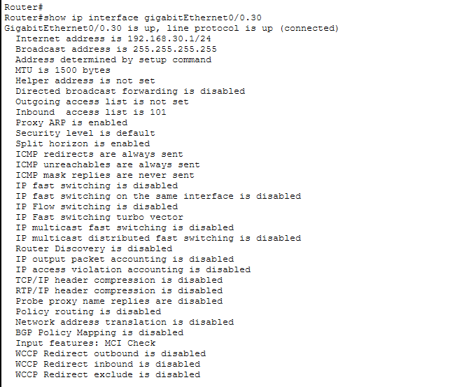
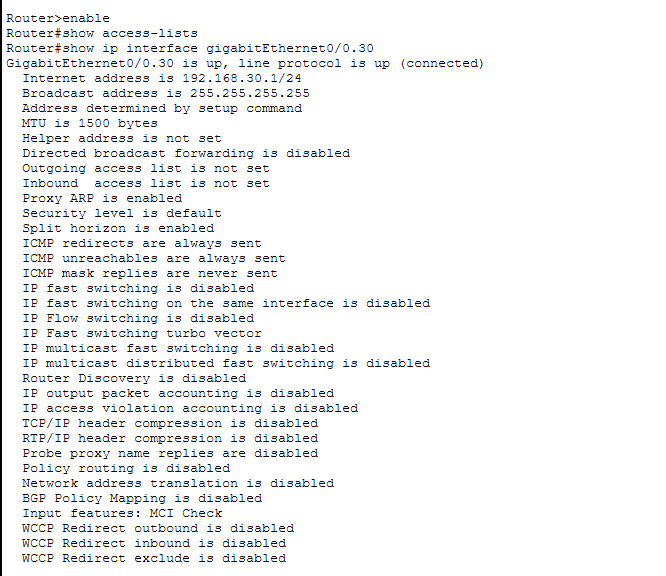
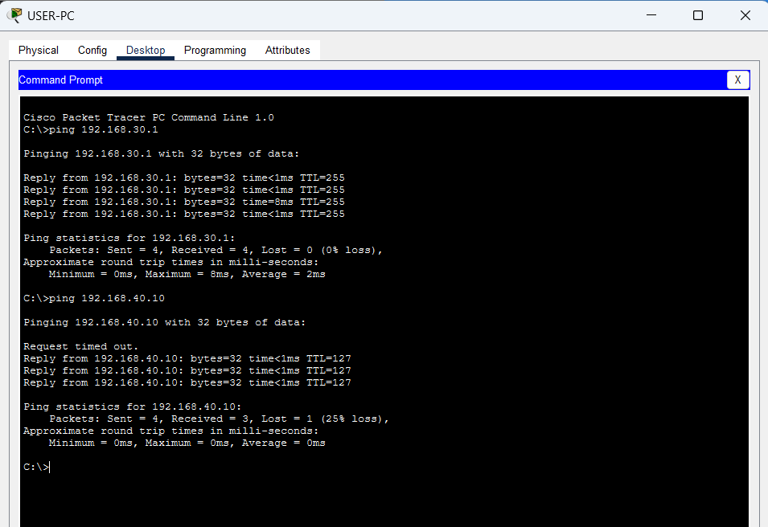

# Incident Report 06 – Access Control List Misconfiguration

## 1. Incident Overview

- **Incident:** Incorrect ACL blocking network traffic
- **Affected device:** R1
- **Affected interface:** GigabitEthernet0/0.30
- **Affected network:** VLAN 30 – Users
- **Severity:** High
- **Category:** Network security configuration error

## 2. Problem Description

An access control list (ACL) was configured on the VLAN 30 router subinterface to deny traffic from the Users network to the Servers network.

As a result, USER-PC could communicate with its default gateway but could not reach the server at `192.168.40.10`.

## 3. Faulty Configuration

```cisco
access-list 101 deny ip 192.168.30.0 0.0.0.255 192.168.40.0 0.0.0.255
access-list 101 permit ip any any

interface GigabitEthernet0/0.30
 ip access-group 101 in
```

### Evidence – Initial Fault



*Figure 1: ACL 101 contains a rule denying traffic from VLAN 30 to VLAN 40.*

## 4. Root Cause

ACL 101 explicitly denied IP traffic from `192.168.30.0/24` to `192.168.40.0/24`.

The ACL was applied inbound on the VLAN 30 subinterface, blocking the affected traffic as it entered the router from the Users network.

## 5. Troubleshooting

1. Tested connectivity to the default gateway and server.
2. Confirmed that the gateway was reachable but the server was not.
3. Inspected ACL rules using:

```cisco
show access-lists
```

4. Checked ACL application using:

```cisco
show ip interface GigabitEthernet0/0.30
```

5. Identified ACL 101 as the cause of the blocked traffic.

### Evidence – Diagnosis



*Figure 2: The router interface confirms that ACL 101 is applied inbound.*

## 6. Corrective Action

Removed the ACL from the router subinterface and deleted the ACL:

```cisco
configure terminal
interface GigabitEthernet0/0.30
 no ip access-group 101 in
exit
no access-list 101
end
```

## 7. Verification

- ACL removed from the router subinterface: Confirmed
- USER-PC to default gateway: Successful
- USER-PC to server: Successful after correcting the secondary DHCP gateway configuration
- Network communication: Restored

### Evidence – ACL Verification



*Figure 3: ACL 101 is no longer applied to the VLAN 30 router subinterface.*

### Evidence – Connectivity Verification



*Figure 4: Successful connectivity between USER-PC, its gateway and the server.*

### Additional Finding – Secondary DHCP Configuration Issue

During recovery, USER-PC was also found to have an incorrect DHCP default gateway (`0.0.0.0`).

The missing `default-router 192.168.30.1` command was added to the `USERS` DHCP pool, and the client renewed its DHCP lease.

This was a secondary configuration issue, separate from the original ACL incident.

## 8. Lessons Learned

- ACLs control which network traffic is permitted or denied.
- ACL placement and direction affect which traffic is filtered.
- `show access-lists` helps identify configured filtering rules.
- `show ip interface` helps verify ACL application.
- Always verify DHCP configuration when troubleshooting client connectivity.
- Secondary configuration issues should be investigated separately from the primary root cause.