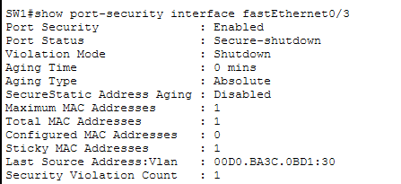
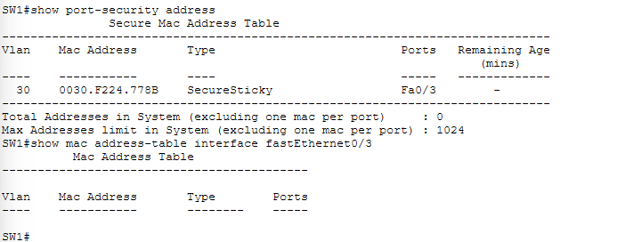
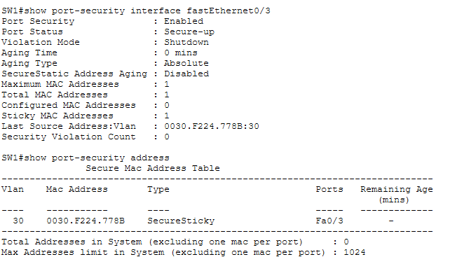
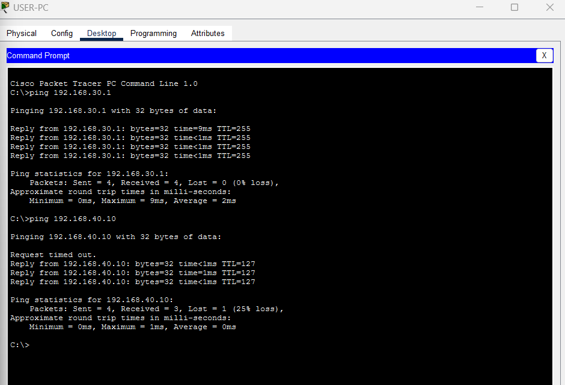

# Incident Report 07 – Port Security Violation

## 1. Incident Overview

- **Incident:** Unauthorized device connected to a secured switch port
- **Affected device:** SW1
- **Affected interface:** FastEthernet0/3
- **Affected VLAN:** VLAN 30 – Users
- **Severity:** High
- **Category:** Network access security

## 2. Problem Description

Port security was configured on SW1 FastEthernet0/3 to allow only one authorized MAC address.

The port learned USER-PC's MAC address using sticky MAC learning.

When IT-PC was connected to the same port, its different MAC address triggered a port-security violation. The switch automatically placed the interface into a secure-shutdown state.

## 3. Security Configuration

```cisco
interface FastEthernet0/3
 switchport mode access
 switchport access vlan 30
 switchport port-security
 switchport port-security maximum 1
 switchport port-security mac-address sticky
 switchport port-security violation shutdown
```

### Evidence – Initial Fault



*Figure 1: FastEthernet0/3 entered Secure-shutdown mode after a port-security violation.*

## 4. Root Cause

An unauthorized device was connected to a switch port configured to permit only one previously learned MAC address.

The unauthorized device's MAC address did not match the secure MAC address stored by the switch.

- **Authorized MAC (USER-PC):** `0030.F224.778B`
- **Unauthorized MAC (IT-PC):** `00D0.BA3C.0BD1`

## 5. Troubleshooting

1. Configured port security on SW1 FastEthernet0/3.
2. Generated traffic from USER-PC to learn its MAC address.
3. Verified the learned address using:

```cisco
show port-security address
```

4. Replaced USER-PC with IT-PC on the secured switch port.
5. Generated traffic from IT-PC.
6. Verified the violation using:

```cisco
show port-security interface FastEthernet0/3
```

7. Confirmed that the port entered `Secure-shutdown` state and the security violation was recorded.
8. Compared the authorized sticky MAC address with the unauthorized device's MAC address.

### Evidence – Diagnosis



*Figure 2: The switch's secure MAC address table identifies USER-PC's authorized sticky MAC address.*

## 6. Corrective Action

Reconnected the authorized USER-PC and recovered the interface:

```cisco
configure terminal
interface FastEthernet0/3
 shutdown
 no shutdown
end
```

The port recovered, and the authorized USER-PC MAC address was retained or relearned through sticky MAC learning.

## 7. Verification

- Port security status: Secure-up
- Authorized MAC address: `0030.F224.778B`
- Maximum secure MAC addresses: 1
- Violation mode: Shutdown
- USER-PC to default gateway: Successful
- USER-PC to server: Successful
- Intranet access through `http://intranet.lab`: Successful

### Evidence – Port Security Verification



*Figure 3: Port security is enabled, the interface is Secure-up, and USER-PC's authorized sticky MAC address is present.*

### Evidence – Connectivity Verification



*Figure 4: USER-PC successfully communicates with the gateway and server after port recovery.*

### Additional Finding – Secondary DHCP Configuration Issue

During recovery, USER-PC was found to have an incorrect DHCP default gateway (`0.0.0.0`).

The DHCP pool was corrected by adding the missing `default-router 192.168.30.1` command, and the client renewed its DHCP lease.

This was a secondary configuration issue, separate from the port-security violation.

## 8. Lessons Learned

- Port security helps prevent unauthorized devices from accessing a switch port.
- Sticky MAC learning dynamically records authorized MAC addresses.
- The maximum secure MAC setting limits the number of permitted devices.
- The violation shutdown action disables a port when an unauthorized MAC address is detected.
- `show port-security interface` helps investigate port-security violations.
- Administrators must restore a secured port carefully after resolving a violation.
- Network connectivity should be verified after recovering a secured interface.